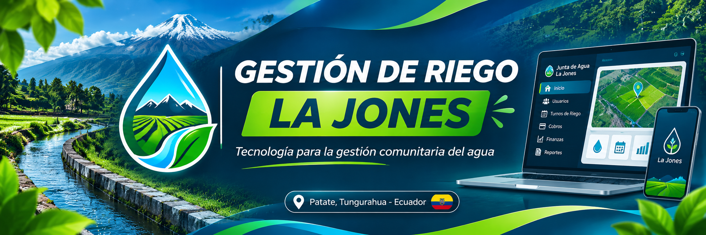
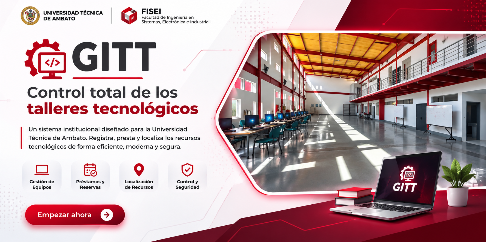

#  Bienvenid@ a mi mundo

## Tecnologías que uso 🌷

  <em>Creando cosas bonitas, útiles y con mucho código ✨</em>

  <table>
    <tr>
      <td align="center" width="130"> <b>JavaScript</b></td>
      <td align="center" width="130"> <b>React</b></td>
      <td align="center" width="130"> <b>Node.js</b></td>
      <td align="center" width="130"> <b>PostgreSQL</b></td>
    </tr>
    <tr>
      <td align="center" width="130"> <b>MySQL</b></td>
      <td align="center" width="130"> <b>MongoDB</b></td>
      <td align="center" width="130"> <b>Docker</b></td>
      <td align="center" width="130">🌸 <b>Made with love</b></td>
    </tr>
  </table>

También trabajo con ☕ Java · 🌐 HTML5 · 📊 R · 🐚 Bash · 🔶 Oracle · 📝 LaTeX · 🐧 Linux

## Proyectos destacados ✨

### [Sistema de Gestión — Junta de Agua y Riego “La Jones”](https://www.linkedin.com/in/melanie-silva-28633b226/details/projects/edit/forms/413642603/)
*Ago. de 2026 – nov. de 2026*

Solución web integral para sistematizar y centralizar la administración comunitaria, financiera y técnica de la Junta de Agua y Riego “La Jones”, en Patate, Tungurahua. Incluye control de usuarios y lotes georreferenciados, turnos de riego, asistencia a asambleas y mingas con multas automáticas, caja y comprobantes PDF, pagos anuales del agua y un portal de autogestión para regantes.

### [GalaxyCell — Gestión de productos tecnológicos](https://www.linkedin.com/in/melanie-silva-28633b226/details/projects/edit/forms/413331025/)
*Jun. de 2026 – ago. de 2026*

Plataforma multiplataforma para administrar catálogos de telefonía y tecnología. Integra productos, marcas, categorías e imágenes en una aplicación móvil Android y una interfaz web en desarrollo, conectadas a una API REST con NestJS y PostgreSQL.

### [U-Ride — Gestión de viajes compartidos](https://www.linkedin.com/in/melanie-silva-28633b226/details/projects/edit/forms/412387946/)
*Abr. de 2026 – jun. de 2026*

Aplicación web para coordinar viajes compartidos entre estudiantes. Permite publicar viajes, solicitar cupos, gestionar perfiles, calificaciones y reportes mediante una interfaz conectada a una API REST con autenticación y actualizaciones en tiempo real.

### [GITT — Gestión de Inventario de Talleres Tecnológicos](https://www.linkedin.com/in/melanie-silva-28633b226/details/projects/edit/forms/410167242/)
*Mar. de 2025 – jun. de 2025*

Aplicación web para administrar los recursos tecnológicos de los talleres de la Facultad de Ingeniería en Sistemas, Electrónica e Industrial (FISEI) de la Universidad Técnica de Ambato (UTA). Centraliza el inventario, los préstamos y la información de los recursos.

## 
Repositorios 👩🏻‍💻

  
  
    
   

###

  

  

###

  

    
🌐 Conoce más sobre mí en mi <a href="https://melaniesilvaportafolios.onrender.com/" target="_blank"><strong>portafolio personal</strong></a>.

